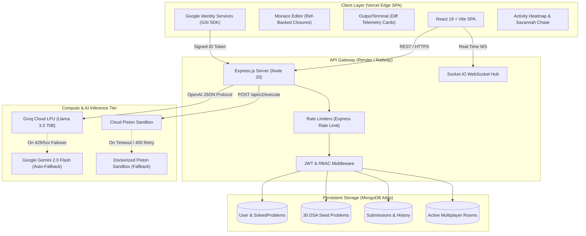

# CodeSync AI — Real-Time Collaborative Coding & AI-Assisted DSA Sandbox

<div align="center">

[](https://code-sync-ai-xi.vercel.app/)
[](https://github.com/shanmukh00001/CodeSync-Ai)
[](https://nodejs.org)
[](https://react.dev)
[](LICENSE)

<br/>

**A production-ready, hands-free cloud platform for real-time collaborative code pair-programming, multi-language sandbox execution, and intelligent AI mentorship.**

[Explore Live App](#-live-deployment) • [Architecture](#-system-architecture) • [Key Features](#-core-features) • [Tech Stack](#-tech-stack) • [Quick Start](#-getting-started) • [API Specs](#-api-reference)

</div>

---

## 🌐 Live Deployment

| Service | Hosting Platform | URL | Status |
|---|---|---|---|
| **Frontend Web App** | Vercel Edge | [https://code-sync-ai-xi.vercel.app/](https://code-sync-ai-xi.vercel.app/) | 🟢 Active |
| **Backend REST & WebSocket API** | Render / Railway | [https://codesync-api.onrender.com](https://codesync-api.onrender.com) | 🟢 Active |
| **Multi-Language Sandbox** | Cloud Piston / Azure VM | `http://172.198.75.210` / Piston v2 | 🟢 Resilient Failover |
| **Database** | MongoDB Atlas Cluster | Managed Cloud DB | 🟢 Active |

> **Note:** If you are deploying to your own custom domain or staging infrastructure, simply update `VITE_API_URL` in `frontend/.env` and `CLIENT_URL` in `backend/.env`.

---

## 💡 About CodeSync AI

**CodeSync AI** transforms traditional algorithmic problem solving and technical interview preparation into a collaborative, gamified, and AI-augmented experience. 

Built with **React 19**, **Node.js / Express**, **MongoDB Atlas**, **Socket.IO**, and **Monaco Editor**, the platform provides:
1. **Zero-Latency Collaborative Rooms:** Write, debug, and review code concurrently with colleagues or interviewers with live editor synchronization, presence tracking, and active participant chat.
2. **Multi-Language Isolated Execution:** Run and submit code in **C++**, **Python**, **JavaScript**, and **Java** against extensive suites of visible and hidden test cases via a resilient, cloud-failover Piston execution engine.
3. **Dual-Tier AI Mentorship (Groq LPU + Google Gemini):** High-speed LLM inference delivering progressive Socratic hints, automated code reviews (time/space complexity, edge cases, anti-patterns), and personalized problem recommendations based on your performance history.
4. **Curated 30-Problem DSA Problem Bank:** Spanning 7 foundational algorithmic paradigms (Arrays, Two Pointers, Stacks, Binary Search, Trees, Dynamic Programming, Greedy) with starter templates and deterministic slug upserts.
5. **Interactive Gamification & Analytics:** 365-day GitHub-style activity heatmaps, solve rates, language proficiency charts, and an interactive **Savannah Chase** daily cadence game.

---

## 🚀 Core Features

### 1. 👥 Real-Time Multiplayer Collaboration
- **Socket.IO Real-Time Sync:** Instant character-level code synchronization across room participants.
- **Monaco Code Editor:** VS Code-grade editing experience featuring syntax highlighting, code folding, bracket colorization, and custom keyboard shortcuts (e.g. `Ctrl+Enter` to Run, `Ctrl+Shift+Enter` to Submit).
- **Presence & Room Controls:** Real-time user list, dynamic host assignment, problem picker inside rooms, and resizable dual-pane problem/editor layout with persistent dimensions.
- **In-Room Discussion Threads:** Integrated real-time room chat and discussion board for collaborative problem breakdown.

### 2. ⚡ Resilient Multi-Language Execution Engine
- Supports **Python 3**, **JavaScript (Node.js)**, **Java**, and **C++**.
- **Dual-Endpoint Resilience:** Connects primarily to cloud-hosted Piston sandboxes with automatic fallback to secondary execution nodes.
- **Timeout Clamping & Parameter Stripping:** Built-in fault tolerance that automatically clamps execution time to 3000ms max and retries payloads with stripped flags to bypass upstream cloud HTTP 400 timeout policies.
- **Glassmorphic Output Terminal:** Rich telemetry chips (status badges, execution runtime, memory footprint, exit codes) and interactive test case diff cards showing exact expected vs. actual outputs.
- **Hidden Test Privacy:** Strict privacy barriers ensuring hidden grading test cases are never leaked to the client during competitive runs.

### 3. 🧠 Dual-Tier AI Inference Engine
- **Primary AI Provider:** High-throughput, sub-second inference powered by **Groq Cloud LPUs** (`Llama 3.3 70B` / `Qwen 2.5 Coder`).
- **Secondary AI Provider:** Seamless, automatic fallback to **Google Gemini 2.0 Flash** on rate limits (HTTP 429) or upstream outages.
- **Socratic AI Hints:** 3-tier progressive hint system (Conceptual Direction → Algorithmic Approach → Code Syntax Clue) designed to guide developers without spoiling solutions.
- **Automated AI Code Review:** Deep AST and semantic code critique evaluating asymptotic complexity ($O(N)$ time/space), potential edge-case failures, code readability, and optimization avenues.
- **Adaptive Recommendations:** Personalized recommendation system that analyzes your historical accuracy, tags, and recent failures to surface optimal next problems.

### 4. 📊 Developer Analytics & Gamification
- **GitHub-Style 365-Day Heatmap:** Comprehensive activity grid tracking daily submissions, acceptance rates, and streak continuity.
- **Savannah Chase Cadence Canvas:** Interactive, physics-driven canvas widget visualizing daily coding velocity, streaks, and momentum milestones.
- **Tri-State Problem Filter:** Instant dashboard filtering across **All**, **Solved**, and **Unsolved** problems with real-time solve synchronization and search reactivity.
- **Self-Healing Analytics:** Automatic background reconciliation that maintains referential integrity between user solve logs and problem catalog seeds.

### 5. 🛡️ Enterprise-Grade Authentication & Security
- **Official Google Identity Services (GSI) OAuth 2.0:** One-tap Google Sign-In with client-side credential decoding and backend JWT verification.
- **Email OTP Verification:** 6-digit OTP delivery via **Nodemailer** for email confirmation, passwordless access, and secure password recovery.
- **Hybrid Account Linking:** Seamless support for Google OAuth accounts to link passwords and switch between authentication methods.
- **Secure Sessions:** HTTP-only, `SameSite=None` (production) / `Lax` (development) secure JWT cookie delivery with Authorization header fallback.
- **Role-Based Access Control (RBAC):** Dedicated administrative portal for dynamic problem authoring, test case creation, and catalog management.

---

## 🏗️ System Architecture



---

## 💻 Tech Stack

| Domain | Technologies & Libraries |
|---|---|
| **Frontend Framework** | React 19, Vite 6, React Router DOM 7 |
| **Code Editor** | Monaco Editor (`@monaco-editor/react`), Custom Glassmorphism CSS |
| **Backend Framework** | Node.js (v20+), Express.js (v5), Cookie-Parser, CORS |
| **Real-Time Sockets** | Socket.IO (v4.8), Socket.IO Client |
| **Database & ODM** | MongoDB Atlas, Mongoose (v9) |
| **AI Providers** | Groq SDK (LPU Inference), Google GenAI SDK (`@google/genai` Gemini Flash) |
| **Sandboxed Execution** | Piston Execution Engine (Multi-language compilation & sandboxing) |
| **Auth & Security** | Google Identity Services (GSI), JWT (`jsonwebtoken`), Bcrypt.js, Zod |
| **Email Services** | Nodemailer (SMTP OTP email delivery) |
| **DevOps & Hosting** | Vercel (Client), Render / Railway (Server), Docker, Cloudflared |

---

## 📂 Project Directory Structure

```text
CodeSync_ai/
├── backend/
│   ├── config/              # Centralized DB & third-party configurations
│   ├── controllers/         # REST API route handlers
│   ├── middleware/          # JWT auth, RBAC, error handlers, rate limiters
│   ├── models/              # Mongoose schemas (User, Problem, Room, Submission)
│   ├── routes/              # Express API routers (auth, rooms, problems, admin)
│   ├── services/
│   │   ├── ai/              # Groq, Gemini & local AI providers + failover factory
│   │   ├── languageRunners/ # Language-specific test harnesses (Python, JS, Java, C++)
│   │   ├── emailService.js  # Nodemailer SMTP OTP transport
│   │   └── pistonService.js # Resilient Piston client with auto-retry logic
│   ├── tests/               # Comprehensive automated test suites
│   ├── seedProblems.js      # 30-problem DSA seed script with multi-language starters
│   ├── server.js            # Express app entry & HTTP server
│   └── socket.js            # Socket.IO room lifecycle & editor synchronization
├── frontend/
│   ├── public/              # Static public assets & favicons
│   ├── src/
│   │   ├── components/      # UI components (MonacoCodeEditor, ActivityHeatmap, AI panels)
│   │   ├── config/          # Centralized API & Socket base URL resolvers
│   │   ├── context/         # AuthContext and state providers
│   │   ├── pages/           # Application views (Home, Dashboard, Room, Workspace, Admin)
│   │   ├── App.jsx          # Route declarations & route guards
│   │   └── main.jsx         # React root mounting
│   └── vercel.json          # SPA rewrite rules for production deployment
├── docs/                    # Architectural reports & engineering journey docs
└── README.md                # Project documentation & deployment guides
```

---

## 🛠️ Getting Started

Follow these steps to run CodeSync AI locally on your machine.

### Prerequisites
- **Node.js** (v18.0.0 or higher, v20 recommended)
- **npm** (v9.0.0 or higher)
- **MongoDB** (Local instance or MongoDB Atlas connection URI)
- **Groq API Key** *(Free tier available at [console.groq.com](https://console.groq.com))* or **Gemini API Key** *(from [aistudio.google.com](https://aistudio.google.com))*

---

### 1. Clone the Repository

```bash
git clone https://github.com/shanmukh00001/CodeSync-Ai.git
cd CodeSync-Ai
```

---

### 2. Configure & Start the Backend

1. Navigate to the backend directory:
   ```bash
   cd backend
   npm install
   ```

2. Create a `.env` file based on `.env.example`:
   ```bash
   cp .env.example .env
   ```

3. Populate the required environment variables in `backend/.env`:
   ```env
   PORT=5000
   MONGO_URI=mongodb+srv://<username>:<password>@cluster.mongodb.net/codesync_ai?retryWrites=true&w=majority
   JWT_SECRET=your_super_secret_jwt_key_here
   CLIENT_URL=http://localhost:5173

   # Sandboxed Execution (Public or Cloud Piston)
   PISTON_URL=https://emkc.org/api/v2/piston

   # AI Mentorship Configuration (Groq with Gemini Fallback)
   AI_PROVIDER=groq
   GROQ_API_KEY=gsk_your_groq_api_key_here
   GROQ_MODEL=llama-3.3-70b-versatile
   GEMINI_API_KEY=AIzaSy_your_gemini_api_key_here
   GEMINI_MODEL=gemini-2.0-flash

   # Email OTP (Optional for local testing, simulator logs to console by default)
   SMTP_USER=your_email@gmail.com
   SMTP_PASS=your_gmail_app_password

   # Google OAuth (Optional for local test)
   GOOGLE_CLIENT_ID=your_google_oauth_client_id.apps.googleusercontent.com
   ```

4. Seed the curated 30-problem DSA catalog into MongoDB:
   ```bash
   node seedProblems.js
   ```

5. Start the backend development server:
   ```bash
   npm run dev
   ```
   *The backend server will initialize on `http://localhost:5000`.*

---

### 3. Configure & Start the Frontend

1. Open a new terminal and navigate to the frontend directory:
   ```bash
   cd frontend
   npm install
   ```

2. Create a `frontend/.env` file:
   ```env
   VITE_API_URL=http://localhost:5000
   VITE_SOCKET_URL=http://localhost:5000
   VITE_GOOGLE_CLIENT_ID=your_google_oauth_client_id.apps.googleusercontent.com
   ```

3. Launch the Vite development server:
   ```bash
   npm run dev
   ```
   *The frontend application will be live at `http://localhost:5173`.*

---

## 🧪 Testing & Verification

CodeSync AI includes a comprehensive automated test suite in `backend/tests/` covering authentication, execution harnesses, and AI services.

Run the automated test suites using:

```bash
# Verify Authentication, OTP, and Password Hashing
node backend/tests/test_auth_otp.js

# Verify Multi-Language Execution (C++, Python, Java, JavaScript)
node backend/tests/verifyAllLanguages.js

# Verify Piston Cloud Resilience & Timeout Fallback
node backend/tests/test_azure_piston.js

# Verify AI Hint & AI Code Review Service
node backend/tests/verifyAiHintService.js
node backend/tests/verifyAiReviewFoundation.js

# Verify Frontend Production Build
cd frontend && npm run build
```

---

## 📡 API Reference

### Authentication & Users (`/api/users` & `/api/auth`)
- `POST /api/users/register` — Register a new account with email, password, and name.
- `POST /api/users/login` — Authenticate credentials; sets HTTP-only JWT cookie.
- `POST /api/users/logout` — Clear session cookie and invalidate token.
- `GET /api/users/profile` — Fetch authenticated user profile, stats, and solve history.
- `POST /api/auth/google` — Google Identity Services OAuth credential exchange.
- `POST /api/users/request-otp` — Request 6-digit email verification code.
- `POST /api/users/verify-otp` — Validate OTP and confirm email verification state.

### Collaborative Rooms (`/api/rooms`)
- `POST /api/rooms` — Create a new collaborative room with custom title and problem.
- `GET /api/rooms/:roomId` — Retrieve room metadata, participants, and current code buffer.
- `POST /api/rooms/:roomId/join` — Join an active collaborative room.
- `POST /api/rooms/:roomId/leave` — Leave a room and notify participants via WebSocket.

### Problem Bank & Execution (`/api/problems` & `/api/submissions`)
- `GET /api/problems` — List all problems with difficulty, tags, and acceptance rates.
- `GET /api/problems/:slug` — Retrieve problem details, constraints, and language starter templates.
- `POST /api/submissions/run` — Execute code against public test cases via Piston.
- `POST /api/submissions/submit` — Submit solution against full public and hidden test cases; updates user solve stats.
- `GET /api/submissions/history/:problemId` — Fetch user's previous code submissions.

### AI Intelligence (`/api/submissions/ai-*`)
- `POST /api/submissions/ai-hint` — Request progressive Socratic hint (Level 1, 2, or 3).
- `POST /api/submissions/ai-review` — Request automated AI complexity and code smell review.
- `GET /api/submissions/recommendations` — Fetch personalized next-problem recommendations.

### Administrative Control (`/api/admin`)
- `POST /api/admin/problems` — Create new DSA problem with multi-language starter code and test cases.
- `PUT /api/admin/problems/:id` — Update existing problem schema and tests.
- `DELETE /api/admin/problems/:id` — Remove problem from problem directory.

---

## 🗺️ Roadmap & Future Horizons

- [x] **Stage 1–12:** Authentication, Room CRUD, Monaco Editor, Multi-Language Piston Harness.
- [x] **Stage 13:** "Hands-Free" Cloud Architecture & Dual-Tier AI Failover (Groq + Gemini).
- [x] **Stage 14:** Official Google Identity Services (GSI) SDK Integration.
- [x] **Stage 15:** Cloud Piston Auto-Retry, Timeout Clamping, and Parameter Stripping.
- [x] **Stage 16:** Glassmorphism UI elevation, Linear/Vercel design system, and Room/Workspace parity.
- [x] **Stage 17:** Savannah Chase canvas game & 365-day GitHub contribution heatmap.
- [x] **Stage 18:** Glassmorphic Output Terminal with dynamic telemetry chips and diff cards.
- [x] **Stage 19:** 30-Problem curated DSA catalog across 7 algorithmic categories.
- [x] **Stage 20:** Deterministic slug-based upserts and self-healing analytics synchronization.
- [ ] **WebRTC Voice & Video Mesh:** Integrated low-latency peer-to-peer audio and video channels directly inside collaborative rooms.
- [ ] **CRDT / Yjs Integration:** Character-by-character live collaborative code editing with conflict-free replicated data types.
- [ ] **Automated Coding Contests:** Timed multiplayer coding contests with live dynamic leaderboards and rating calculations.

---

## 📄 License

This project is licensed under the [MIT License](LICENSE) — see the LICENSE file for details.

---

## 👨‍💻 Author

**Shanmukha Naga Sai Neduri**
- **GitHub:** [@shanmukh00001](https://github.com/shanmukh00001)
- **Repository:** [https://github.com/shanmukh00001/CodeSync-Ai](https://github.com/shanmukh00001/CodeSync-Ai)

<div align="center">
⭐ If you found this project helpful or inspiring, please consider starring the repository!
</div>
